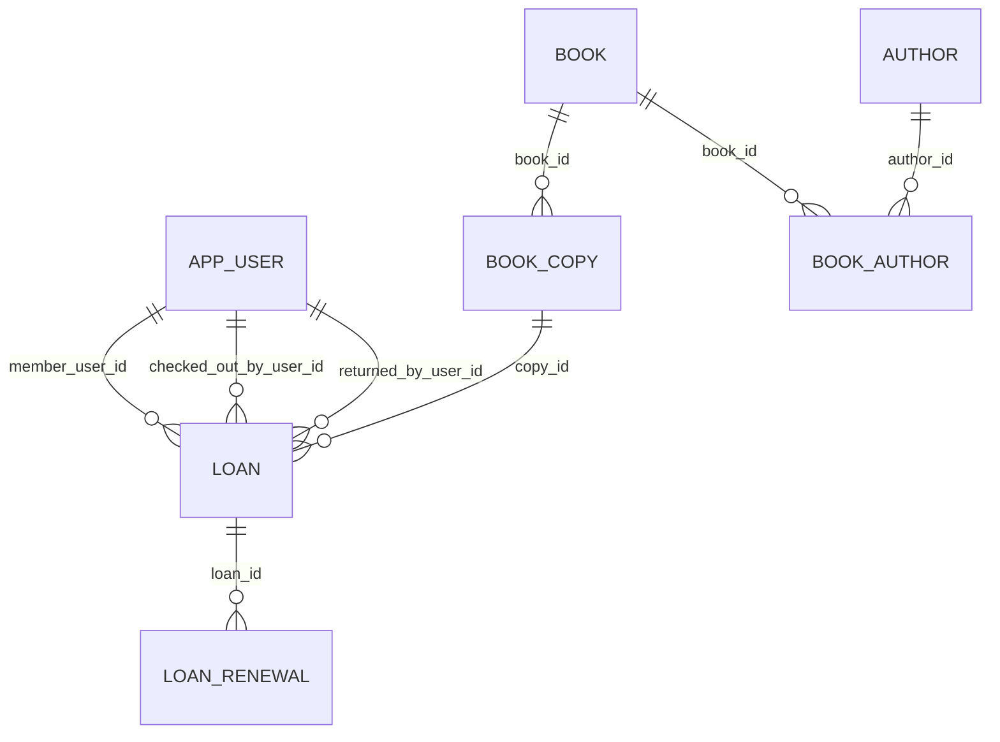

# library-management-system

도서관의 대출·반납·연체 관리를 위한 데이터 모델 저장소입니다.
현재 저장소의 핵심 산출물은 PostgreSQL DDL(`database/schema.sql`)이며, 아래 문서는 기존 Wiki 내용을 기준으로 업무 규칙을 재정리한 고정(Fix) 문서입니다.

## 1) 범위와 설계 원칙

- ISBN은 **ISBN-13(하이픈 제거)** 기준으로 저장합니다.
- 대출은 서지(`book`)가 아닌 **실물 소장본(`book_copy`) 단위**로 처리합니다.
- 대출/반납 처리자(사서) 이력을 보존합니다.
- 반납된 대출 이력과 연장 이력을 삭제하지 않고 보존합니다.
- 참조 무결성을 위해 주요 FK는 `ON DELETE RESTRICT`를 사용합니다.

## 2) 데이터 모델 요약

### 핵심 엔티티

- `app_user`: 회원/사서/관리자 계정
- `book`: ISBN 기준 서지 정보
- `author`, `book_author`: 저자 및 도서-저자 다대다
- `book_copy`: 실제 대출되는 실물 소장본
- `loan`: 대출/반납 이력
- `loan_renewal`: 대출 연장 이력

### ERD (논리 관계)

## 3) 업무 규칙(Fix)

아래 규칙은 스키마 제약조건 + 서비스 계층 규칙을 합쳐 운영 시 반드시 지켜야 하는 기준입니다.

1. **회원/권한**
   - `role`은 `MEMBER | LIBRARIAN | ADMIN`만 허용합니다.
   - 대출 대상은 `MEMBER`만 가능하며, 대출/반납 처리는 `LIBRARIAN`만 수행합니다.
   - 처리 사서 ID는 요청 본문이 아니라 인증된 로그인 세션에서 취득합니다.

2. **도서/소장본**
   - 같은 ISBN-13은 하나의 `book` 행으로 관리합니다.
   - `book_copy.copy_code`는 전역 유일해야 합니다.
   - 소장본의 현재 대출 가능 여부는 `management_status`가 아니라
     **`loan.returned_at IS NULL`인 활성 대출 존재 여부**로 판단합니다.

3. **대출**
   - 대출 생성 시 `checked_out_by_user_id`는 필수입니다.
   - 기본 대출 기간은 14일이며 기준식:
     `(borrowed_at AT TIME ZONE 'Asia/Seoul')::date + 14`
   - 회원은 동시에 1건만 대출 가능(활성 대출 유니크 인덱스).
   - 소장본도 동시에 1건만 대출 가능(활성 대출 유니크 인덱스).

4. **연장**
   - 연장은 미반납·비연체 상태에서만 허용합니다.
   - 기본 정책은 1회 연장, 7일 증가(`current_due_date + 7`)입니다.
   - `loan.current_due_date` 갱신과 `loan_renewal` 이력 생성은 동일 트랜잭션으로 처리합니다.

5. **반납**
   - 반납 시 `returned_at`과 `returned_by_user_id`는 동시에 기록합니다.
   - 둘 중 하나만 기록되는 상태는 허용하지 않습니다(쌍 제약).

6. **연체**
   - 연체 기준:
     `returned_at IS NULL AND current_due_date < (CURRENT_TIMESTAMP AT TIME ZONE 'Asia/Seoul')::date`

7. **동시성/무결성**
   - 대출/반납/연장은 행 잠금 + 트랜잭션으로 경쟁 상태를 방지합니다.
   - 회원 비활성화는 미반납 대출이 없을 때만 허용합니다.

## 4) 구현 기준 파일

- DDL: `database/schema.sql`
