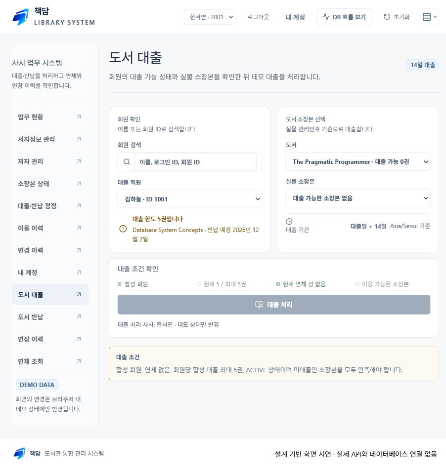
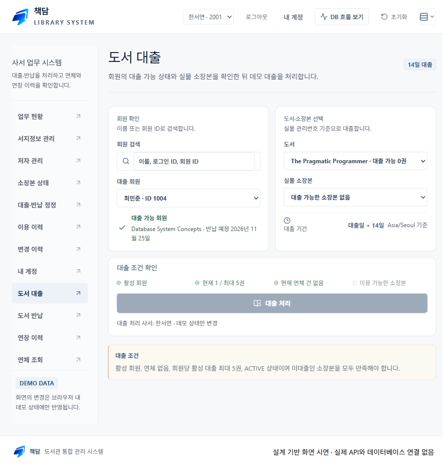
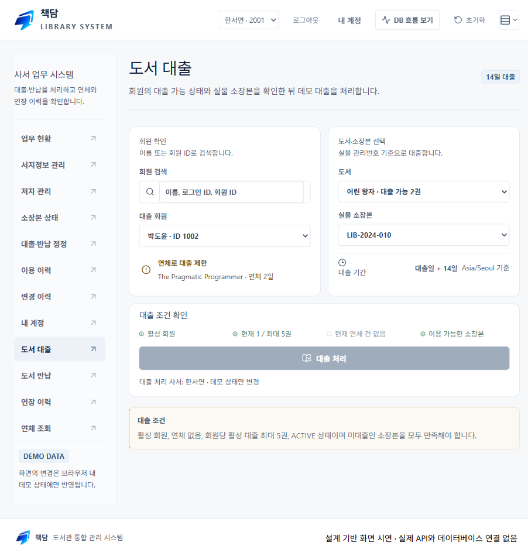
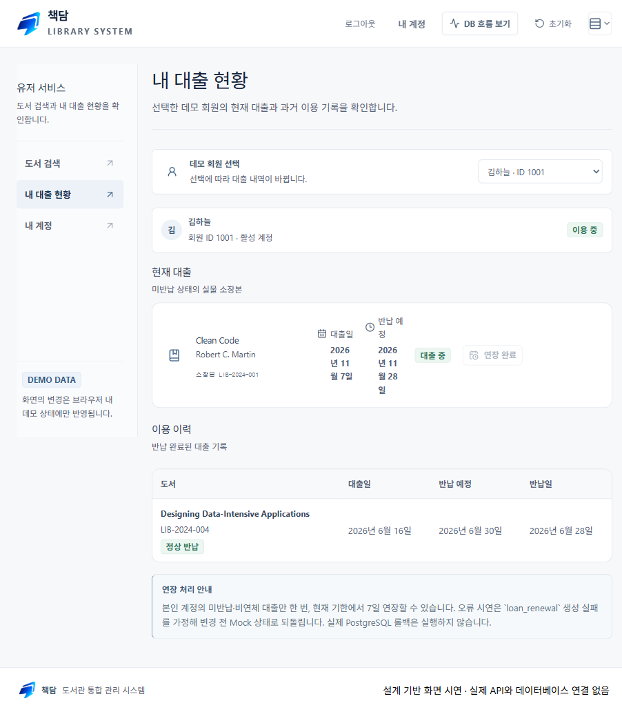
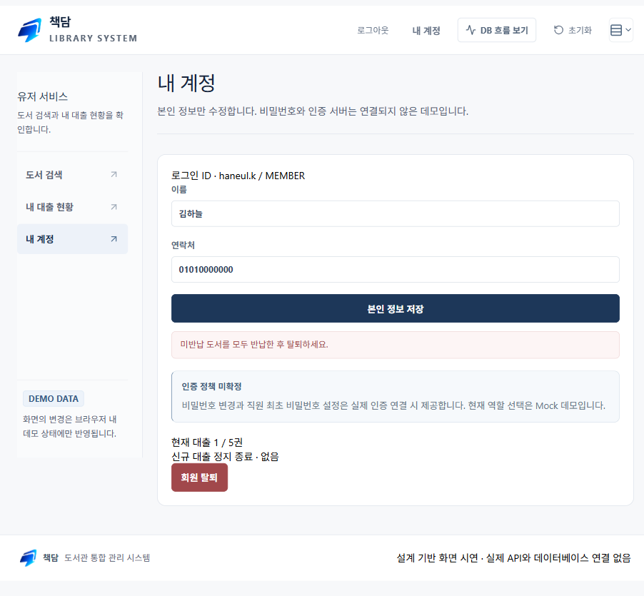

# 책담 — 발표팀 공유용 핵심 조사자료

> 목적: **발표팀이 PPT에 넣을 내용을 선택하고, 기능·DB 중심 질의응답을 준비하도록 돕는 참고 자료**입니다. 발표 순서·15분 시간표·대본은 정하지 않습니다.
>
> 기준: 제공된 `FINAL_PRESENTATION_BRIEF.md`의 조사 결과와 [책담 GitHub Wiki](https://github.com/2026-02-db-01/library-management-system/wiki), `database/schema.sql` 등에 관한 기록. **현재 5개 시연은 프론트엔드 Mock에서 관찰한 결과이며, PostgreSQL에서 SQL을 실행하거나 실제 API 연동까지 검증한 결과가 아닙니다.**

## 1. 발표 때 넣으면 좋은 내용 — DB 중심 조사 결과

아래는 **우선순위가 높은 발표 소재**입니다. 전부 발표하라는 뜻이 아니라, 발표팀이 평가 관점에 맞춰 선택하면 됩니다.

| 우선 | 넣으면 좋은 핵심 내용 | 왜 중요한가 / 실제 사례 | 발표에 사용할 근거 |
|---|---|---|---|
| **1** | **BOOK과 BOOK_COPY 분리** | 같은 도서를 여러 권 보유할 수 있으므로 서지정보와 실물을 별도로 식별. 대출은 `book_copy.copy_id`를 기준으로 처리. 복본마다 제목을 저장할 때의 갱신 이상을 설명하기 좋음 | ERD: `BOOK 1:N BOOK_COPY`, `BOOK_COPY 1:N LOAN(시간에 따른 이력)` / BR-17 |
| **2** | **BOOK–AUTHOR의 다대다 관계와 정규화** | 공동저자·한 저자의 여러 도서를 `BOOK_AUTHOR`로 연결. `(book_id, author_id)` 복합 PK는 같은 연결의 중복을 방지 | 논리 ERD, 복합 PK/FK DDL / 정규화·이상 현상 근거 |
| **3** | **중복 대출 방지: 부분 UNIQUE 인덱스** | 과거 반납 이력을 남기면서 **현재 유효 미반납 소장본의 중복 점유만** 금지. 단순 `UNIQUE(copy_id)`와 왜 다른지 설명 가능 | `uq_loan_valid_unreturned_copy` / BR-05·38 |
| **4** | **회원당 5권 한도: DB 제약과 서버 책임 구분** | `CHECK`로 한 회원의 여러 LOAN 행을 안전하게 집계할 수 없음. 서버에서 **회원 행 잠금 → 유효 미반납 건수 재검사 → 대출 확정** 필요 | `LOAN`, `idx_loan_active_member_due`, EX01 / BR-03·38 |
| **5** | **소장본 상태와 대출 가능 여부의 분리** | `ACTIVE/DAMAGED/RETIRED`는 실물 관리 상태이고, 실제 대출 가능 여부는 ACTIVE인지와 현재 유효 미반납 LOAN 존재 여부로 계산 | `v_copy_availability`, `v_book_availability` / BR-20·24 |
| **6** | **반납·연장·연체 데이터 설계** | LOAN은 삭제하지 않고 반납시각을 기록. 연장은 기존 LOAN의 만기일 +7일과 `LOAN_RENEWAL` 성공 이력 1건으로 관리. 연체 판정은 **KST 달력 날짜** 기준 | `uq_loan_renewal_loan`, `ck_loan_renewal_plus_7_days`, `fn_overdue_days` / BR-07·11~14·52 |
| **7** | **정정·이력 보존과 트랜잭션 원자성** | 잘못된 대출·반납을 원본 삭제로 처리하지 않고 정정 이력을 유지. 상태 변경과 이력 기록이 둘 다 성공하거나 전체 롤백되어야 함 | `BOOK_CHANGE_HISTORY`, `COPY_STATUS_HISTORY`, `LOAN_CORRECTION_HISTORY` / BR-30~32·42~45 |
| **8** | **회원 탈퇴 시 개인정보와 대출 이력의 분리** | 미반납이 있으면 탈퇴 차단. 탈퇴 가능할 때는 회원 식별 연결을 해제하면서 **소장본 기준 비식별 대출 이력**은 보존. 요청·JSONB 스냅샷의 재식별 가능성도 점검 | `app_user`, `loan.member_user_id`의 NULL 허용, `REQUEST_RECORD` / BR-16·46~49 |
| **9** | **중복 업무요청 방지(멱등성)** | 동일 UUID와 동일 요청 지문은 재처리하지 않고 기존 결과 반환, 같은 UUID로 다른 내용을 보내면 충돌 처리하도록 설계 | `request_record` UUID PK, `request_fingerprint` / FR-21·BR-37 |

**물리 DB 설계 현황:** 제공 문서의 `schema.sql` 정적 조사에는 **12개 테이블, FK 19개, 명시적 인덱스 15개, 함수 7개, 뷰 3개, 트리거 4개**가 기록되어 있습니다. *실제 PostgreSQL에 적용해 실행 성공한 개수는 아닙니다.* 기존 문서 중 일부에는 구버전 모델이 있으므로 최종 발표 자료는 최신 DDL과 ERD가 일치하는지 다시 대조해야 합니다.

**가장 보여주기 좋은 SQL 근거 두 가지:**

```sql
-- 현재 같은 소장본에 유효한 미반납 대출은 1건만 허용
CREATE UNIQUE INDEX uq_loan_valid_unreturned_copy
ON loan (copy_id)
WHERE is_cancelled = FALSE AND returned_at IS NULL;
```

```sql
-- 6번째 대출 요청 전 회원의 실제 미반납 건수 재검사에 쓰는 집계
SELECT count(*) AS open_loan_count
FROM loan
WHERE member_user_id = :member_user_id
  AND is_cancelled = FALSE
  AND returned_at IS NULL;
```

**설명 시 주의:** 두 번째 SELECT만 실행한다고 동시성 문제가 해결되지는 않습니다. 모든 관련 변경 경로가 같은 회원 잠금 규약을 따르고, 잠금 이후 다시 조회해야 합니다. 또한 `EXPLAIN`이나 대량 데이터 성능은 이번 발표의 주제가 아니므로, 실제 실험 근거가 준비된 경우에만 부가 자료로 사용합니다.

## 2. 예상 질문과 심층 질문 — 발표팀 답변 참고

### 기본 예상 질문

| 질문 | 답변 핵심 | 근거 |
|---|---|---|
| **Q01. 왜 BOOK과 BOOK_COPY를 구분했나요?** | 공통 서지와 개별 실물의 생명주기가 다르고, 같은 책 여러 권에 서로 다른 대출·파손 상태가 존재할 수 있기 때문입니다. | BR-17 |
| **Q02. BOOK_AUTHOR가 왜 필요한가요?** | 책과 저자는 M:N 관계입니다. 복합 PK가 동일 책–저자 연결 중복을 차단합니다. | 논리 모델 |
| **Q03. ISBN을 기본키로 쓰지 않은 이유는?** | ISBN이 없는 도서가 허용되므로 별도 `book_id`가 필요합니다. 값이 있는 ISBN은 UNIQUE로 관리합니다. | BR-18·39 |
| **Q04. 저자 이름에 UNIQUE를 걸지 않은 이유는?** | 동명이인이 존재할 수 있으므로 `author_id`가 실제 저자 식별자입니다. | `AUTHOR` 물리 모델 |
| **Q05. BOOK_COPY의 ACTIVE는 대출 가능과 같은 뜻인가요?** | 아닙니다. 정상 상태여도 유효 미반납 대출이 있으면 대출할 수 없습니다. | BR-20 |
| **Q06. 반납하면 LOAN 행을 삭제하나요?** | 삭제하지 않고 반납시각과 처리자를 기록해 이력을 보존합니다. | BR-06·09 |
| **Q07. 왜 LOAN_RENEWAL을 따로 두나요?** | 기존 대출 건은 유지하고 연장 전후 만기일과 연장 시점을 이력으로 보존하기 위해서입니다. | BR-11~13 |
| **Q08. 회원·사서·관리자 권한 차이는?** | 사서는 도서·대출 업무, 관리자는 직원 계정 업무를 담당합니다. 관리자가 사서 기능을 자동으로 모두 갖는 구조가 아닙니다. | BR-10 |
| **Q09. 제적 도서를 그냥 삭제하지 않은 이유는?** | 과거 대출·변경 이력의 참조를 보존하기 위해 `RETIRED` 상태를 사용합니다. | BR-23 |
| **Q10. 조회용 View는 무엇을 하나요?** | 도서·소장본의 보유/대출 가능 수량과 현재 연체 상태를 업무별 조회 형태로 제공합니다. | `v_book_availability` 등 |
| **Q11. 정규화를 통해 어떤 이상을 줄였나요?** | 복본마다 도서 제목을 중복 저장하는 갱신 이상, 저자 목록을 문자열로 관리하는 검색·수정 이상 등을 줄였습니다. | ERD·정규화 근거 |
| **Q12. 역할과 제약조건을 DB만으로 전부 보장하나요?** | 아닙니다. FK/CHECK/UNIQUE로 보장되는 범위와, 로그인·업무·여러 행을 검증해야 하는 서버 책임을 분리했습니다. | 물리 모델 책임 분담 |

### 날카로운 심층 질문·꼬리질문

| 질문 | 핵심 답변 / 추가로 확인할 지점 |
|---|---|
| **D01. 회원당 최대 5권인데 왜 CHECK 제약을 쓰지 않았나요?** | 일반 CHECK는 해당 행 중심 검증입니다. 다른 LOAN 행 수를 합산하는 규칙은 서버 트랜잭션에서 잠금 및 재검사가 필요합니다. **EX01 화면은 프론트 제한만 증명**합니다. |
| **D02. 두 사서가 대출 4권인 회원에게 동시에 한 권씩 대출하면?** | 두 요청이 모두 4건을 읽는 경쟁이 발생할 수 있습니다. 같은 `app_user` 행을 잠그고 첫 요청 확정 후 재조회해 다음 요청을 거부해야 합니다. 실제 다중 세션 검증은 별도입니다. |
| **D03. 소장본의 전체 `copy_id`에 UNIQUE를 걸면 더 간단하지 않나요?** | 과거 반납 대출까지 1건만 허용되어 재대출 이력을 저장할 수 없습니다. `is_cancelled = FALSE AND returned_at IS NULL` 조건의 부분 UNIQUE가 필요합니다. |
| **D04. 프론트 버튼만 비활성화하면 중복 대출이 막히나요?** | 아닙니다. 직접 API 호출이나 동시 요청을 막을 수 없습니다. 서버의 권한·업무 재검사와 DB 제약이 필요합니다. |
| **D05. 저자가 0명인 도서는 FK가 막아주나요?** | FK는 존재하지 않는 저자 참조를 막지만, 모든 BOOK에 저자 연결이 최소 1건 있어야 한다는 조건은 보장하지 않습니다. 등록 트랜잭션에서 검증해야 합니다. |
| **D06. DAMAGED만 보유한 책은 검색할 수 있나요?** | 일반 검색에 노출하지만 대출 가능 수는 0권입니다. 소장본 0권 또는 전부 RETIRED인 경우 일반 검색에서는 제외합니다. | 
| **D07. 연장을 두 번 동시에 누르면 어떻게 되나요?** | 서비스가 상태를 검사하고 `loan_renewal.loan_id` UNIQUE가 성공 연장 이력 중복을 막도록 설계되었습니다. 만기일 변경과 이력 저장은 같은 트랜잭션이어야 합니다. |
| **D08. 연장 중 이력 INSERT가 실패하면 만기일 변경만 남나요?** | 그래서는 안 됩니다. `LOAN.current_due_date` 변경과 `LOAN_RENEWAL` INSERT를 하나의 트랜잭션으로 묶어 전체 롤백해야 합니다. |
| **D09. 반납 예정일 당일 23:59에 반납하면 연체인가요?** | 아니요. `Asia/Seoul` 기준 실제 날짜가 예정일보다 이후일 때 연체입니다. |
| **D10. 연체 3일로 인한 대출 정지는 언제 끝나나요?** | 실제 반납 확정시각부터 72시간 뒤입니다. 여러 연체 건이 있다면 종료시각을 합산하지 않고 최댓값을 적용합니다. |
| **D11. 연체 도서를 반납해 정지 기간만 남았는데 연장도 막나요?** | 신규 대출은 제한되지만, 현재 미반납 연체가 없고 나머지 조건을 충족하면 기존 대출 연장은 가능할 수 있습니다. | 
| **D12. 이미 재대출된 소장본의 이전 반납을 취소하면요?** | 후속 대출이 있으면 자동 미반납 복원을 거부해야 합니다. 후속 대출이 반납된 경우도 무조건 복원하면 안 됩니다. | 
| **D13. 왜 `loan.member_user_id`는 NULL을 허용하나요?** | 회원 탈퇴 후 신원 연결을 해제하고도 과거 소장본 기준 대출 이력을 보존하기 위해서입니다. 신규 대출에 회원이 없어도 된다는 뜻은 아닙니다. |
| **D14. JSONB 스냅샷에 이름·전화번호가 남으면 탈퇴 비식별화가 무의미하지 않나요?** | 맞습니다. 대출·요청·정정 이력의 재식별 가능한 필드까지 제한·정리해야 합니다. FK만 NULL 처리하는 것으로 충분하지 않습니다. |
| **D15. 마지막 활성 관리자 1명을 보호할 때 두 관리자의 동시 비활성화는요?** | 단순히 사전 COUNT만 하면 경합 위험이 있습니다. 모든 관리자 상태 변경의 공통 직렬화 규칙과 트랜잭션 재검사가 필요합니다. |
| **D16. 같은 UUID를 두 번 보내면 두 건 처리되지 않나요?** | 동일 UUID·동일 지문이면 이전 결과를 반환하고, 같은 UUID·다른 지문이면 충돌로 거부하도록 설계합니다. 실제 서버 동작 검증은 아직 별도입니다. |
| **D17. SQLSTATE 오류가 발생한 것으로 프론트 캡처가 증명하나요?** | 아닙니다. 지금 캡처는 Mock UI의 제한·경고 상태이며 PostgreSQL 제약 위반·ROLLBACK의 증거가 아닙니다. |
| **D18. 12테이블과 인덱스가 DDL에 있으면 DB 구현이 완료된 건가요?** | DDL 정의 확인과 PostgreSQL 적용·업무 API·트랜잭션·동시성 수용 테스트는 별개입니다. 현재 제공 문서에서는 DB 런타임 실행 결과를 확인하지 못했습니다. |

**교수님 질문이 이어질 때 가장 위험한 구분:** `화면에서 차단` ≠ `서버가 거부` ≠ `DB 제약조건이 INSERT를 거부`입니다. 각 단계에서 실제로 검증한 범위까지만 설명해야 합니다.

## 3. 예외 시연 스크린샷 5개 — 발표용 증거 설명

> **이미지 자료:** 사용자 제공 실제 브라우저 캡처 5장을 각 검증 설명 바로 아래에 삽입했습니다. **모든 화면은 Mock UI에서 관찰한 결과**이며, 실제 백엔드·PostgreSQL 무결성 검증 결과는 아닙니다. GitHub에서 본 MD와 `evidence/` 폴더를 같은 구조로 보관하면 이미지가 함께 표시됩니다.

### EX01. 회원당 대출 한도 5권 — 6번째 대출 제한

**관찰한 화면:** 회원의 유효 미반납 건수가 **5/5권**으로 표시되고, **“대출 한도 5권입니다”** 안내가 보임. 대출 제출 버튼은 **비활성화**되어 있었으며 실제 여섯 번째 요청은 전송되지 않음.



**발표에 넣을 이유:** 5권 제한이라는 **다중 행 업무 규칙**을 설명하기 좋음. **Wiki:** FR-12, BR-03·38. **SQL 연결:** `loan`의 회원별 유효 미반납 건수 집계. **증거 수준:** Mock UI 사전 차단, 실제 PostgreSQL 미검증.

### EX02. 이미 대출된 소장본 — 가용 소장본 0권 안내

**관찰한 화면:** 선택한 도서에서 **“대출 가능한 소장본 없음”** 상태가 보였으며 대출 버튼이 비활성화됨. **동일 관리번호로 두 번째 INSERT를 시도한 화면은 아님.**



**발표에 넣을 이유:** `BOOK_COPY`와 `LOAN`을 이용한 가용성 계산 및 **부분 UNIQUE 인덱스의 설계 취지**로 연결 가능. **Wiki:** BR-05·38. **증거 수준:** 가용 0 Mock UI 확인, 중복 INSERT의 DB 차단 미검증.

### EX03. 현재 연체 회원 — 신규 대출 제한

**관찰한 화면:** 다른 대출 가능 도서를 선택했더라도 **“연체로 대출 제한”** 메시지가 보이고, 연체 2일 안내와 함께 대출 버튼이 비활성화됨.



**발표에 넣을 이유:** 소장본이 대출 가능하더라도 **회원 자격 조건** 때문에 대출이 제한될 수 있다는 점. **Wiki:** BR-04·07·14, FR-15~16. **SQL 연결:** `fn_overdue_days`, `v_active_loan_status`. **증거 수준:** Mock UI 사전 차단.

### EX04. 대출 연장 최대 1회 — 재연장 제한 상태

**관찰한 화면:** 기존 만기일 **2026-11-21 → 2026-11-28**로 7일 연장된 후, 버튼이 **“연장 완료”**로 비활성화됨. 두 번째 연장 요청을 서버/DB에 보내지는 않음.



**발표에 넣을 이유:** `LOAN`의 만기일 변경과 `LOAN_RENEWAL` 이력 1건을 연결해 설명하기 좋음. **Wiki:** BR-11~14. **DB 근거:** `uq_loan_renewal_loan`, +7일 CHECK. **증거 수준:** Mock UI 제한, 실제 UNIQUE 오류 미검증.

### EX05. 미반납 회원 — 탈퇴 확정 시도 후 거부

**관찰한 화면:** 현재 대출이 남아 있는 회원이 **“탈퇴 확정”**을 눌렀고, **“미반납 도서를 모두 반납한 후 탈퇴하세요.”**라는 실제 메시지가 표시됨. 페이지와 회원 상태가 유지됨.



**발표에 넣을 이유:** 단순한 버튼 제한이 아닌 **실제 사용자 조작에 대한 거부 메시지**이며, 회원 탈퇴 시 FK 연결·개인정보·이력 처리까지 확장해서 설명할 수 있음. **Wiki:** FR-23, BR-16·46~49. **증거 수준:** Mock UI 탈퇴 거부, 실제 PostgreSQL 비식별 트랜잭션 미검증.

**공유 방법:** GitHub에서 본 문서 링크를 발표팀에 전달하면 다섯 장의 예외 시연 캡처가 설명과 함께 표시됩니다. Notion으로 가져오는 경우에도 이미지 경로를 확인하고 필요하면 PNG를 직접 첨부합니다.
